<picture id="top">
  <source media="(prefers-reduced-motion: reduce)" srcset="assets/hero-static.png">
   turn_ideas_into_intelligent_systems(). Status: open to work.">
</picture>

  <b>Ravi Gohel</b> · AI / ML engineer in the making · B.Tech CSE (AI &amp; ML) student 
  Practical AI, computer vision, GenAI and RAG — and the full-stack products around them. <b>Open to work.</b>

  
  
  
  
  

<h2 id="the-human"><a href="#the-human">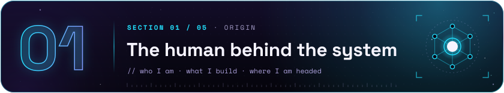</a></h2>

  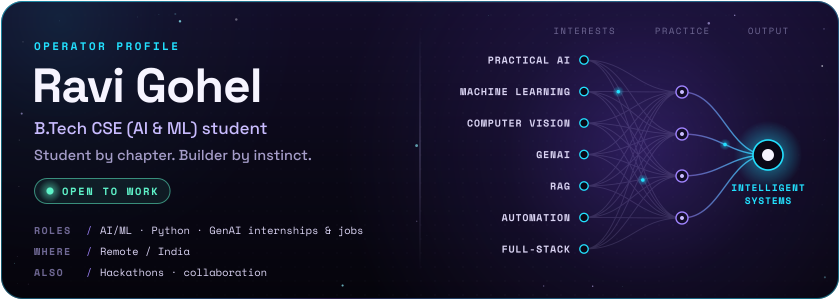

I'm **Ravi Gohel**, a B.Tech Computer Science & Engineering (AI & ML) student who learns by building. I like practical AI that leaves the notebook: machine learning, computer vision, GenAI and retrieval-augmented generation (RAG), automation, and the full-stack products that put them in front of people.

- **Looking for:** AI/ML, Python and GenAI internships or jobs, remote or in India.
- **Up for:** hackathons, side projects and collaboration.

<h2 id="build-archive"><a href="#build-archive">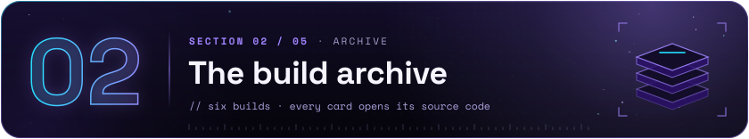</a></h2>

  <a href="https://github.com/ravigohel142996/NeuroCore-AI-The-Autonomous-Decision-Engine-for-Businesses">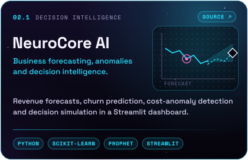</a>
  <a href="https://github.com/ravigohel142996/Orbital-Sentinel-Earth-AI">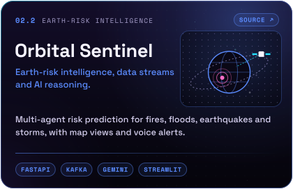</a>
   
  <a href="https://github.com/ravigohel142996/GuardianVision-AI">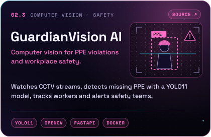</a>
  <a href="https://github.com/ravigohel142996/LoanGuardian-AI">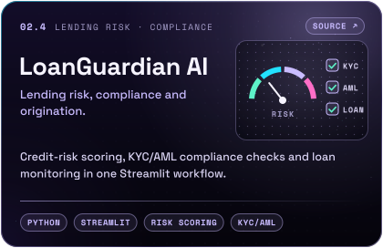</a>
   
  <a href="https://github.com/ravigohel142996/enterprise-rag-os">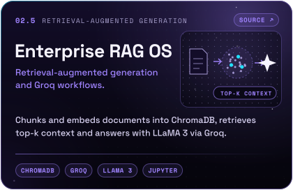</a>
  <a href="https://github.com/ravigohel142996/Relief_mate_ai">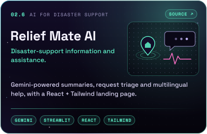</a>

<b>Plain-text project index</b> — the same six builds as a table

 

| # | Project | Focus | Built with | Source |
| :-- | :-- | :-- | :-- | :-- |
| 02.1 | **NeuroCore AI** | Business forecasting, anomalies and decision intelligence | Python · scikit-learn · Prophet · Streamlit | [NeuroCore-AI](https://github.com/ravigohel142996/NeuroCore-AI-The-Autonomous-Decision-Engine-for-Businesses) |
| 02.2 | **Orbital Sentinel** | Earth-risk intelligence, data streams and AI reasoning | FastAPI · Kafka · Gemini · Streamlit | [Orbital-Sentinel-Earth-AI](https://github.com/ravigohel142996/Orbital-Sentinel-Earth-AI) |
| 02.3 | **GuardianVision AI** | Computer vision for PPE violations and workplace safety | YOLO11 · OpenCV · FastAPI · Docker | [GuardianVision-AI](https://github.com/ravigohel142996/GuardianVision-AI) |
| 02.4 | **LoanGuardian AI** | Lending risk, compliance and origination | Python · Streamlit · risk scoring · KYC/AML | [LoanGuardian-AI](https://github.com/ravigohel142996/LoanGuardian-AI) |
| 02.5 | **Enterprise RAG OS** | Retrieval-augmented generation and Groq workflows | ChromaDB · Groq · LLaMA 3 · Jupyter | [enterprise-rag-os](https://github.com/ravigohel142996/enterprise-rag-os) |
| 02.6 | **Relief Mate AI** | Disaster-support information and assistance | Gemini · Streamlit · React · Tailwind | [Relief_mate_ai](https://github.com/ravigohel142996/Relief_mate_ai) |

<h2 id="tools-of-the-trade"><a href="#tools-of-the-trade">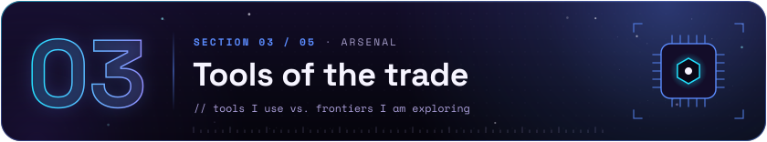</a></h2>

  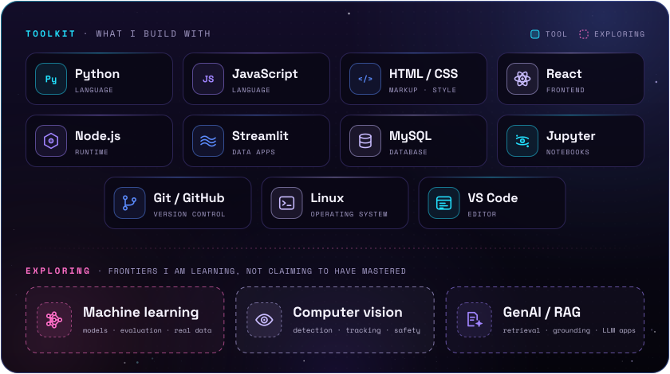

**Build with:** Python · JavaScript · HTML/CSS · React · Node.js · Streamlit · MySQL · Jupyter · Git/GitHub · Linux · VS Code 
**Exploring:** machine learning · computer vision · GenAI / RAG

<h2 id="proof-of-work"><a href="#proof-of-work">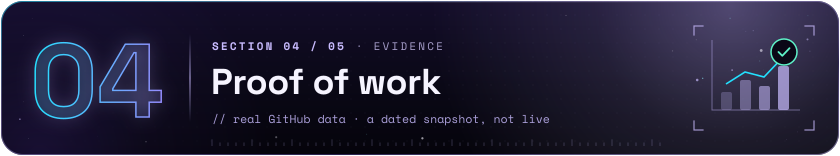</a></h2>

  

Generated from GitHub’s public REST API by <code>scripts/update_metrics.py</code> and refreshed weekly by a GitHub Action — a dated snapshot, not live telemetry.

<h2 id="next-mission"><a href="#next-mission">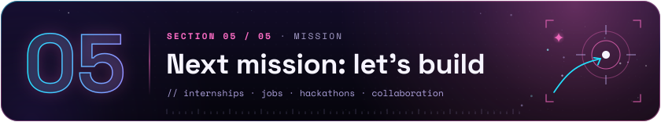</a></h2>

  <a href="https://www.linkedin.com/in/ravi-gohel/">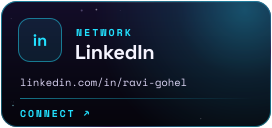</a>
  <a href="https://portfolioravigohel.netlify.app/">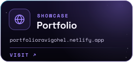</a>
  <a href="mailto:ravi.n.gohel811@gmail.com">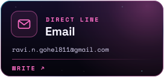</a>

  Hiring for an AI/ML, Python or GenAI role, or putting a hackathon team together? Let's talk. 
  <a href="https://www.linkedin.com/in/ravi-gohel/">LinkedIn</a> · <a href="https://portfolioravigohel.netlify.app/">Portfolio</a> · <a href="mailto:ravi.n.gohel811@gmail.com">ravi.n.gohel811@gmail.com</a>

  <a href="#top">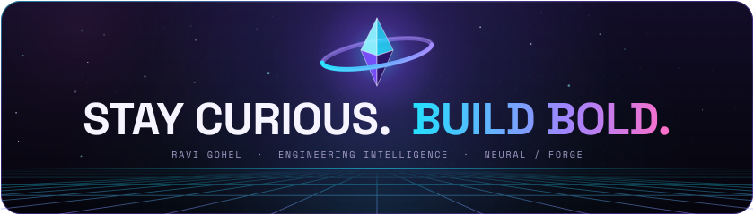</a>

  <a href="#top">↑ Back to top</a> 
  Every image here is rendered from code in <code>scripts/</code>. Type: Space Grotesk and Space Mono, SIL Open Font License 1.1.

