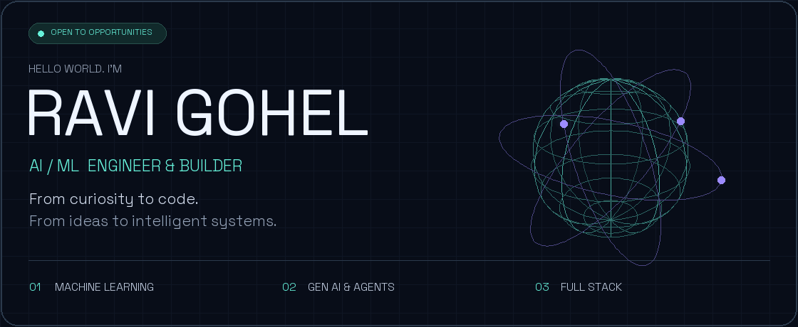
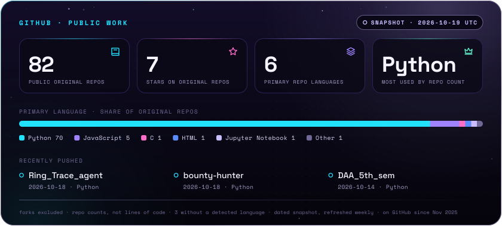

<picture>
  <source media="(prefers-reduced-motion: reduce)" srcset="./assets/hero-static.png">
  
</picture>

### Building intelligent systems for real-world problems.

B.Tech CSE (AI & ML) student · Python developer · Full-stack builder

**[Portfolio ↗](https://portfolioravigohel.netlify.app/)** &nbsp; / &nbsp; **[LinkedIn ↗](https://www.linkedin.com/in/ravi-gohel/)** &nbsp; / &nbsp; **[Email ↗](mailto:ravi.n.gohel811@gmail.com)** &nbsp; / &nbsp; **[Explore my work ↗](https://github.com/ravigohel142996?tab=repositories)**

[About](#01--the-builder) · [Projects](#02--selected-builds) · [Stack](#03--my-toolbox) · [GitHub](#04--building-in-public) · [Let's talk](#05--lets-build-something)

---

## 01 / The builder

I'm **Ravi**, a computer science student focused on **artificial intelligence and machine learning**. I enjoy turning ambitious ideas into working projects—from decision-intelligence dashboards to computer vision and AI assistants.

- **Building:** AI-powered tools, automation workflows, and useful web experiences.
- **Exploring:** generative AI, retrieval-augmented generation, multi-agent systems, and ML monitoring.
- **Looking for:** AI/ML, Python, or GenAI internships and job opportunities—**remote / India**.
- **Happy to collaborate on:** hackathons, open source, and practical AI projects.

> **My direction:** less hype, more building. Make it useful, make it understandable, and keep improving it.

## 02 / Selected builds

A few projects from my public repositories. Open a project for its source, setup instructions, and current status.

<table>
<tr>
<td width="50%" valign="top">

### 🧠 NeuroCore AI
**Decision intelligence for business**

Revenue forecasting, customer churn prediction, cost anomaly detection, and strategic decision simulation.

`Python` `Machine Learning` `Streamlit`

[Explore the repository →](https://github.com/ravigohel142996/NeuroCore-AI-The-Autonomous-Decision-Engine-for-Businesses)

</td>
<td width="50%" valign="top">

### 🌍 Orbital Sentinel
**Earth-risk intelligence**

A multi-agent project exploring global risk prediction using data streams, AI reasoning, and a voice interface.

`Python` `Gemini` `Streamlit`

[Explore the repository →](https://github.com/ravigohel142996/Orbital-Sentinel-Earth-AI)

</td>
</tr>
<tr>
<td width="50%" valign="top">

### 👁️ GuardianVision AI
**Computer vision for workplace safety**

Monitor CCTV streams, detect personal protective equipment violations, and alert safety teams.

`Python` `Computer Vision` `Safety AI`

[Explore the repository →](https://github.com/ravigohel142996/GuardianVision-AI)

</td>
<td width="50%" valign="top">

### 🏦 LoanGuardian AI
**Risk, compliance & loan origination**

A unified dashboard bringing lending risk and compliance workflows into one place.

`Python` `Streamlit` `Risk Analytics`

[Explore the repository →](https://github.com/ravigohel142996/LoanGuardian-AI)

</td>
</tr>
<tr>
<td width="50%" valign="top">

### 📚 Enterprise RAG OS
**Retrieval-augmented generation**

An exploration of RAG pipelines and Groq-powered language-model workflows.

`Python` `Jupyter` `RAG` `Groq`

[Explore the repository →](https://github.com/ravigohel142996/enterprise-rag-os)

</td>
<td width="50%" valign="top">

### 🛟 Relief Mate AI
**AI for disaster assistance**

A project addressing access to shelter, medical aid, and rescue information during disasters.

`Python` `AI for Good` `Disaster Response`

[Explore the repository →](https://github.com/ravigohel142996/Relief_mate_ai)

</td>
</tr>
</table>

**[More experiments, systems, and builds →](https://github.com/ravigohel142996?tab=repositories)**

## 03 / My toolbox

| Area | Tools & interests |
| :--- | :--- |
| **AI & data** | Python · Machine learning · Computer vision · Generative AI · RAG |
| **Interfaces** | Streamlit · React · JavaScript · HTML · CSS |
| **Backend & storage** | Node.js · MySQL · API integration |
| **Developer workflow** | Git · GitHub · Linux · VS Code · Jupyter |
| **Currently exploring** | Multi-agent orchestration · Model reliability · AI automation |

## 04 / Building in public

Generated from GitHub's API and refreshed weekly with GitHub Actions. Forks are excluded; languages count each repository's primary language, not lines of code. This is a dated snapshot, not a live contribution counter.

**[Browse repositories ↗](https://github.com/ravigohel142996?tab=repositories)** &nbsp; · &nbsp; **[View contribution activity ↗](https://github.com/ravigohel142996?tab=overview)**

## 05 / Let's build something

Have an AI problem, an internship opportunity, or a hackathon idea? **I'd love to connect.**

| Connect | Find me here |
| :--- | :--- |
| **Professional network** | [linkedin.com/in/ravi-gohel](https://www.linkedin.com/in/ravi-gohel/) |
| **Email** | [ravi.n.gohel811@gmail.com](mailto:ravi.n.gohel811@gmail.com) |
| **Portfolio** | [portfolioravigohel.netlify.app](https://portfolioravigohel.netlify.app/) |
| **Code & collaboration** | [github.com/ravigohel142996](https://github.com/ravigohel142996) |

---

**Curiosity → Code → Impact**

Designed with a little orbital energy. Built to keep evolving.

[Back to the top ↑](#)

<!-- Maintenance: see .github/PROFILE_MAINTENANCE.md for asset regeneration and automation. -->
